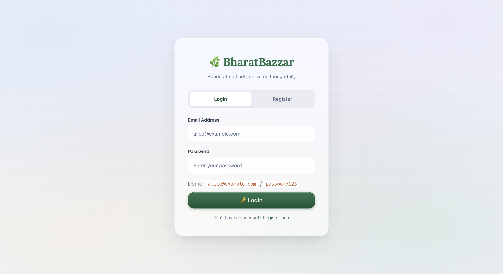
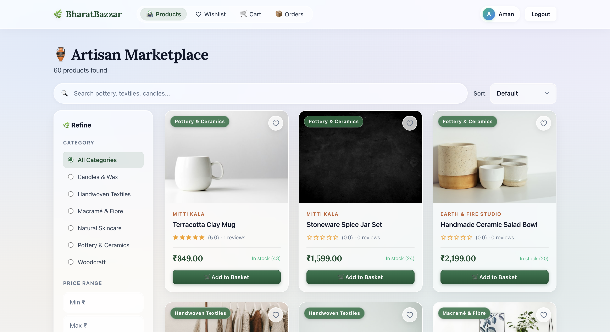
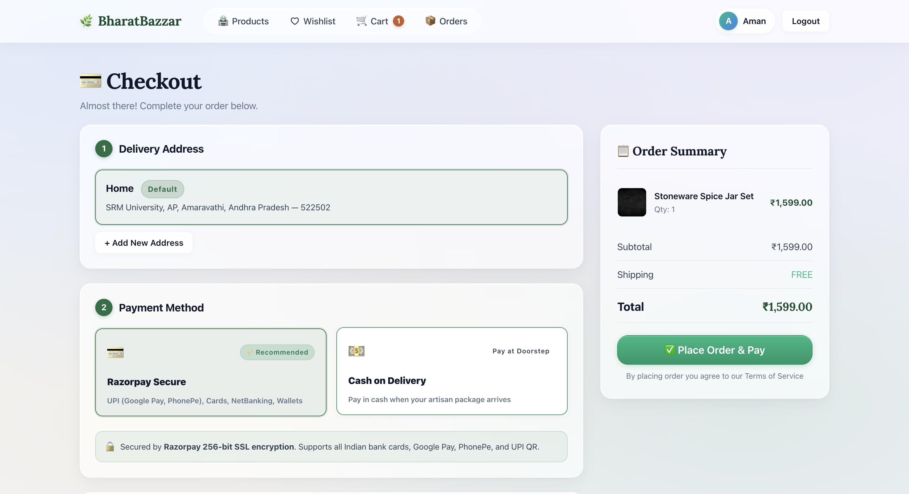
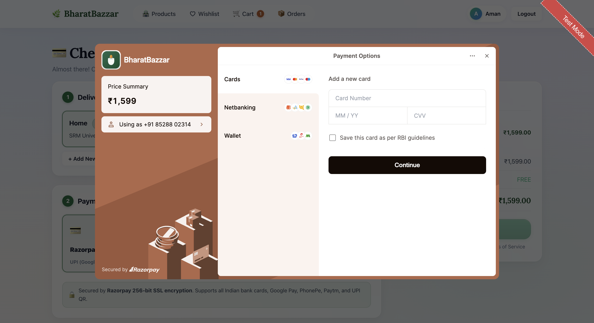
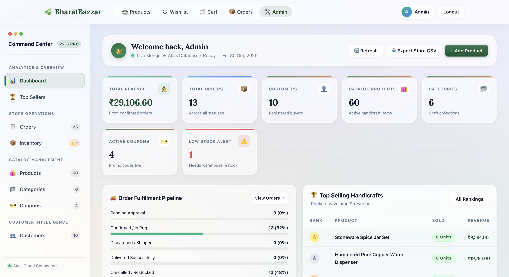

# 🛒 BharatBazzar — Artisanal Indian Handicrafts E-Commerce Platform

[](https://nodejs.org/)
[](https://expressjs.com/)
[](https://www.mongodb.com/cloud/atlas)
[](https://razorpay.com/)
[](https://vercel.com/)
[](https://render.com/)
[](scratch/)

**BharatBazzar** is a modern, full-stack e-commerce platform dedicated to authentic Indian artisanal handicrafts. Featuring an Apple **MacBook Glassy** design system, a robust **Node.js/Express REST API**, a cloud-hosted **MongoDB Atlas** database, official **Razorpay** payment gateway integration, and a full-featured **Admin Command Center**.

The project is completely **deployment-ready** with zero-config blueprints for **Vercel** (Frontend) and **Render** (Backend).

---

## 🌟 Key Highlights & Features

### 🛍️ Customer Experience (Storefront)
* **MacBook Glassy UI**: macOS frosted glassmorphic materials (`backdrop-filter: blur(28px)`), specular light borders, soft elevation shadows, and Apple SF typography.
* **Artisanal Catalog (60 Products)**: Spanning 6 heritage crafts:
  1. 🏺 *Pottery & Ceramics* (Khurja blue pottery, Terracotta planters, studio ceramics)
  2. 🪔 *Brass & Metalware* (Moradabad brassware, Dhokra tribal art, copper dispensers)
  3. 🪵 *Woodcraft* (Saharanpur carved wood, channapatna toys, sheesham trays)
  4. 🧵 *Textiles & Handloom* (Pashmina shawls, Ikat throws, block print quilts)
  5. 🎨 *Paintings & Folk Art* (Madhubani, Warli, Pichwai wall plates)
  6. 🎋 *Bamboo & Natural Fiber* (Assam bamboo lamps, Jute runners, Sabai grass baskets)
* **Instant Filtering & Shimmer Loaders**: Real-time category selection, price range filtering, multi-field search, and CSS keyframe shimmer skeletons.
* **Interactive Shopping Basket & Wishlist**: Quantity adjusters, stock validation, promo code validation with instant discount calculation, and 1-click wishlist-to-cart migration.
* **Dual Secure Checkout**:
  * **Razorpay Gateway**: Official checkout popup supporting UPI, Credit/Debit cards, Net Banking, with server-side HMAC-SHA256 signature verification.
  * **Cash on Delivery (COD)**: Frictionless order confirmation.
* **Order History & Self-Service Cancellation**: Real-time order tracking with automatic inventory stock restoral upon cancellation.
* **Ratings & Customer Reviews**: Star rating system with verified customer feedback.

### 🛡️ Admin Command Center (`admin.html`)
* **Live Overview & KPI Cards**: Real-time revenue tracking, order volume, catalog count, low-stock alerts, and active coupon counts.
* **Fulfillment Pipeline Visualizer**: Progress bars indicating order distribution (*Pending*, *Confirmed*, *Shipped*, *Delivered*, *Cancelled*).
* **Warehouse Quick Stock Adjuster**: Inline `[-5]`, `[-1]`, numeric input, `[+1]`, `[+5]`, and `[Save]` buttons directly inside the inventory table for warehouse adjustments.
* **Product Catalog CRUD**: Modal creation and editing with **Live Image URL Preview** and deactivation controls.
* **Promotional Coupons Engine**: Percentage vs flat discounts, minimum order threshold, usage limits, and toggle switches.
* **Customer Directory & RBAC**: Admin/Customer role management with self-demotion and self-deletion safeguards.
* **One-Click CSV Data Export Suite**: Instant CSV generation for Orders, Products, Inventory, Customers, and Top Sellers.
* **Mobile Drawer Navigation**: Collapsible frosted glass navigation menu for mobile and tablet screens.

---

##  📸 Screenshots

🖥️ Login & Dashboard

<div align="center">
  <table>
    <tr>
      <td align="center" width="50%">
        <b>Login Page</b><br/><br/>
        
      </td>
      <td align="center" width="50%">
        <b>Dashboard</b><br/><br/>
        
      </td>
    </tr>
  </table>
</div>
<br/>

⸻

🛍️ Order & Payment

<div align="center">
  <table>
    <tr>
      <td align="center" width="50%">
        <b>Order Page</b><br/><br/>
        
      </td>
      <td align="center" width="50%">
        <b>Razorpay Payment Gateway</b><br/><br/>
        
      </td>
    </tr>
  </table>
</div>
<br/>

⸻

⚙️ Admin Dashboard

<div align="center">
  
</div>

⸻

## 📁 Repository Structure

```
DBMS-Project/
├── render.yaml                 ← Render Infrastructure as Code (1-Click Backend Deploy)
├── vercel.json                 ← Vercel Root Routing & API Proxy Rewrites
├── README.md                   ← Full Project Documentation
│
├── backend/
│   ├── server.js               ← Express entry point & health check routes
│   ├── package.json            ← Dependencies & npm scripts (start, seed)
│   ├── .env.example            ← Environment variable template
│   ├── config/
│   │   ├── db.js               ← MongoDB Atlas Mongoose connection pool
│   │   └── razorpay.js         ← Razorpay client initialization
│   ├── models/
│   │   ├── User.js             ← User accounts & role management
│   │   ├── Product.js          ← Product catalog & active listings
│   │   ├── Inventory.js        ← Independent 3NF stock levels
│   │   ├── Category.js         ← Hierarchical category taxonomy
│   │   ├── Cart.js             ← Active user shopping carts
│   │   ├── Order.js            ← Order headers & snapshot items
│   │   ├── Payment.js          ← Razorpay & COD payment records
│   │   ├── Address.js          ← Customer shipping addresses
│   │   ├── Coupon.js           ← Promo codes & redemption rules
│   │   ├── Review.js           ← Product customer reviews
│   │   └── Counter.js          ← Auto-increment integer sequence generator
│   ├── controllers/            ← Modular REST business logic
│   ├── middleware/
│   │   └── auth.js             ← JWT token validation & admin-only guards
│   ├── routes/                 ← Express API endpoint definitions
│   └── seed-mongo.js           ← Database seeding script (60 items, categories, users)
│
├── frontend/
│   ├── index.html              ← Auth portal (Login & Registration)
│   ├── products.html           ← Catalog with category filter & search
│   ├── product-details.html    ← Artisan item showcase & customer reviews
│   ├── cart.html               ← Basket management & coupon engine
│   ├── wishlist.html           ← Saved items gallery
│   ├── checkout.html           ← Shipping addresses & Razorpay / COD payment
│   ├── orders.html             ← Customer order tracking & cancellation
│   ├── admin.html              ← MacBook Glassy Admin Command Center
│   ├── vercel.json             ← Subdirectory Vercel deployment configuration
│   ├── css/
│   │   └── style.css           ← Design system (Apple Glassmorphism, typography)
│   ├── js/
│   │   ├── config.js           ← Runtime backend API URL configuration
│   │   └── api.js              ← Centralized fetch client, JWT session & toasts
│   └── images/
│       └── favicon.svg         ← Authentic project SVG brand mark
│
└── database/
    ├── schema.sql              ← Legacy relational SQL schema (for reference)
    ├── seed.sql                ← Legacy SQL sample dataset (for reference)
    └── er_diagram.md           ← Entity Relationship diagram & normalization notes
```

---

## 🚀 Deployment Guide (Vercel + Render)

Deploying BharatBazzar is configured for a two-tier cloud architecture:
* **Backend**: Hosted on **Render** (Free Web Service)
* **Frontend**: Hosted on **Vercel** (Fast Edge Network)
* **Database**: Hosted on **MongoDB Atlas** (Free M0 Sandbox Cluster)

```
┌──────────────────────────┐               ┌──────────────────────────┐
│   Vercel Edge Network    │   /api/*      │   Render Cloud Service   │
│ (Vanilla JS + Glassy UI) │ ────────────> │  (Node.js / Express API) │
│  *.vercel.app            │ (CORS-Free)   │   *.onrender.com         │
└──────────────────────────┘               └────────────┬─────────────┘
                                                        │
                                                        ▼
                                           ┌──────────────────────────┐
                                           │   MongoDB Atlas Cloud    │
                                           │ (Cluster0 / shopdb DB)   │
                                           └──────────────────────────┘
```

---

### Step 1 — Setup MongoDB Atlas Database

1. Sign in to [MongoDB Atlas](https://www.mongodb.com/cloud/atlas).
2. Create a free **M0 Sandbox** cluster.
3. Under **Database Access**, create a user (e.g. `shopadmin`) with read/write privileges.
4. Under **Network Access**, click **Add IP Address** and select **Allow Access from Anywhere** (`0.0.0.0/0`) so Render and Vercel can connect securely.
5. In **Database** > **Connect**, copy your connection string:
   ```
   mongodb+srv://<username>:<password>@cluster0.mongodb.net/?retryWrites=true&w=majority
   ```

---

### Step 2 — Deploy Backend to Render

#### Option A: 1-Click Blueprint (Recommended)
1. Push your repository to GitHub.
2. Sign in to [Render Dashboard](https://dashboard.render.com/).
3. Click **New +** > **Blueprint**.
4. Connect your GitHub repository. Render automatically reads [`render.yaml`](file:///Users/ammu/Projects/DBMS-Project/render.yaml).
5. Enter your `MONGODB_URI`, `RAZORPAY_KEY_ID`, and `RAZORPAY_KEY_SECRET` when prompted.
6. Click **Apply**. Render will build and deploy your API!

#### Option B: Manual Web Service Setup
1. On the Render Dashboard, click **New +** > **Web Service**.
2. Connect your GitHub repository.
3. Configure the following settings:
   * **Name**: `bharatbazzar-backend`
   * **Root Directory**: `backend`
   * **Runtime**: `Node`
   * **Build Command**: `npm install`
   * **Start Command**: `npm start`
   * **Health Check Path**: `/api/health`
4. Under **Environment Variables**, add:
   | Key | Value | Note |
   | :--- | :--- | :--- |
   | `MONGODB_URI` | `mongodb+srv://...` | Your Atlas connection string |
   | `DB_NAME` | `shopdb` | Database name |
   | `PORT` | `10000` | Render assigns this dynamically |
   | `JWT_SECRET` | `your_secure_random_string` | Secret for signing auth tokens |
   | `JWT_EXPIRES_IN` | `7d` | Token lifetime |
   | `PAYMENT_PROVIDER`| `razorpay` | Payment engine |
   | `RAZORPAY_KEY_ID` | `rzp_test_...` | Razorpay Dashboard Key ID |
   | `RAZORPAY_KEY_SECRET`| `your_secret` | Razorpay Secret Key |
   | `CURRENCY` | `INR` | Default currency |
   | `CLIENT_URL` | `*` | Or your Vercel URL e.g. `https://bharatbazzar.vercel.app` |
5. Click **Create Web Service**.
6. Once deployed, seed the database with catalog items:
   * Go to Render **Shell** tab and run:
     ```bash
     npm run seed
     ```
   * Or run it locally once pointing `MONGODB_URI` in `backend/.env` to Atlas.
7. Note down your Render backend URL (e.g. `https://bharatbazzar-backend.onrender.com`).

---

### Step 3 — Deploy Frontend to Vercel

1. Sign in to [Vercel](https://vercel.com/).
2. Click **Add New...** > **Project** and import your GitHub repository.
3. Set your backend URL using **either** of these two methods:

#### Method 1: Using Vercel Rewrites (Zero CORS issues — Recommended)
Open [`vercel.json`](file:///Users/ammu/Projects/DBMS-Project/vercel.json) in the repository and update the destination with your Render URL:
```json
{
  "rewrites": [
    {
      "source": "/api/:match*",
      "destination": "https://bharatbazzar-backend.onrender.com/api/:match*"
    },
    {
      "source": "/(.*)",
      "destination": "/frontend/$1"
    }
  ]
}
```
* Deploy the project on Vercel with **Root Directory** as `.` (root).

#### Method 2: Setting Runtime Config
In [`frontend/js/config.js`](file:///Users/ammu/Projects/DBMS-Project/frontend/js/config.js), set your Render backend URL:
```javascript
window.BACKEND_API_URL = 'https://bharatbazzar-backend.onrender.com/api';
```
* Deploy on Vercel with **Root Directory** set to `frontend`.

4. Click **Deploy**. Your storefront is now live at `https://your-project.vercel.app`! 🎉

---

## 💻 Local Development Setup

### 1. Clone & Configure Environment
```bash
git clone https://github.com/your-username/DBMS-Project.git
cd DBMS-Project

# Copy backend environment template
cp backend/.env.example backend/.env
```

### 2. Configure `backend/.env`
Edit `backend/.env` with your credentials:
```env
MONGODB_URI=mongodb+srv://<username>:<password>@cluster0.mongodb.net
DB_NAME=shopdb
PORT=5001
JWT_SECRET=local_development_secret_key_123
JWT_EXPIRES_IN=7d
PAYMENT_PROVIDER=razorpay
RAZORPAY_KEY_ID=rzp_test_your_key_id
RAZORPAY_KEY_SECRET=your_razorpay_key_secret
CURRENCY=INR
CLIENT_URL=*
```

### 3. Install Dependencies & Seed Database
```bash
cd backend
npm install

# Seed 60 authentic products, categories, coupons, and demo accounts
npm run seed
```

### 4. Start the Application
```bash
# Start backend server
npm start
```
The server will start on port `5001`. Open your browser:
* **Storefront**: [http://localhost:5001](http://localhost:5001)
* **Admin Dashboard**: [http://localhost:5001/admin.html](http://localhost:5001/admin.html)
* **Health Endpoint**: [http://localhost:5001/api/health](http://localhost:5001/api/health)

---

## 🔑 Default Credentials

| Role | Email | Password | Permissions |
| :--- | :--- | :--- | :--- |
| **Store Administrator** | `admin@shop.com` | `password123` | Full access to Admin Command Center (`admin.html`), inventory, products CRUD, order fulfillment, coupons, and user management |
| **Demo Customer** | `alice@example.com` | `password123` | Browsing catalog, shopping basket, wishlist, Razorpay/COD checkout, order history |

---

## 📡 REST API Reference

All requests and responses use JSON. Authenticated endpoints require the `Authorization: Bearer <JWT>` header.

### 🔐 Authentication (`/api/auth`)
| Method | Endpoint | Description | Auth Required |
| :--- | :--- | :--- | :--- |
| `POST` | `/api/auth/register` | Register new customer account & initialize cart | No |
| `POST` | `/api/auth/login` | Authenticate with email/password and obtain JWT | No |
| `GET` | `/api/auth/me` | Retrieve profile of currently authenticated user | Yes |

### 🛍️ Products & Catalog (`/api/products`)
| Method | Endpoint | Description | Auth Required |
| :--- | :--- | :--- | :--- |
| `GET` | `/api/products` | Retrieve catalog with `category`, `search`, `min_price`, `max_price`, `sort` | No |
| `GET` | `/api/products/categories` | List all 6 craft categories with active counts | No |
| `GET` | `/api/products/:id` | Get detailed product information, stock status & reviews | No |

### 🛒 Shopping Cart (`/api/cart`)
| Method | Endpoint | Description | Auth Required |
| :--- | :--- | :--- | :--- |
| `GET` | `/api/cart` | View active cart items with prices and stock status | Yes |
| `POST` | `/api/cart/add` | Add product to cart `{ product_id, quantity }` | Yes |
| `PUT` | `/api/cart/update` | Update item quantity in cart `{ product_id, quantity }` | Yes |
| `DELETE` | `/api/cart/remove/:id` | Remove specific product from cart | Yes |
| `DELETE` | `/api/cart/clear` | Clear all items from cart | Yes |

### 💖 Wishlist (`/api/wishlist`)
| Method | Endpoint | Description | Auth Required |
| :--- | :--- | :--- | :--- |
| `GET` | `/api/wishlist` | Retrieve saved items for current user | Yes |
| `GET` | `/api/wishlist/ids` | Array of product IDs in wishlist (for UI state) | Yes |
| `POST` | `/api/wishlist/add` | Save product to wishlist `{ product_id }` | Yes |
| `DELETE` | `/api/wishlist/:id` | Remove product from wishlist | Yes |
| `POST` | `/api/wishlist/move-to-cart/:id` | Migrate item from wishlist directly to cart | Yes |

### 💳 Orders & Payments (`/api/orders`)
| Method | Endpoint | Description | Auth Required |
| :--- | :--- | :--- | :--- |
| `GET` | `/api/orders/payment-config` | Public endpoint exposing payment provider and Key ID | No |
| `POST` | `/api/orders/create-razorpay-order` | Calculate totals & create official Razorpay Order | Yes |
| `POST` | `/api/orders/verify-razorpay` | Verify HMAC-SHA256 signature, deduct stock & confirm order | Yes |
| `POST` | `/api/orders/place` | Place Cash on Delivery order `{ address_id, coupon_code }` | Yes |
| `GET` | `/api/orders` | Customer's order history | Yes |
| `GET` | `/api/orders/:id` | Detailed order info with line items and payment record | Yes |
| `PUT` | `/api/orders/:id/cancel` | Cancel order with automatic warehouse stock restoral | Yes |
| `POST` | `/api/orders/validate-coupon` | Validate coupon applicability `{ code }` | Yes |
| `GET` | `/api/orders/addresses` | List customer shipping addresses | Yes |
| `POST` | `/api/orders/addresses` | Add new shipping address | Yes |

### 🛡️ Admin Command Center (`/api/admin`)
*(Requires JWT with `role: "admin"`)*

| Method | Endpoint | Description |
| :--- | :--- | :--- |
| `GET` | `/api/admin/stats` | Dashboard KPIs (revenue, orders, low stock, users) |
| `GET` | `/api/admin/orders` | Full order fulfillment hub listing |
| `GET` | `/api/admin/orders/:id` | Deep inspection with items and payment gateway logs |
| `PUT` | `/api/admin/orders/:id/status` | Update fulfillment state (*shipped, delivered, cancelled*) |
| `GET` | `/api/admin/products` | Manage product catalog |
| `POST` | `/api/admin/products` | Create new product and initialize inventory stock |
| `PUT` | `/api/admin/products/:id` | Update product details and active visibility |
| `DELETE` | `/api/admin/products/:id` | Soft-deactivate product from storefront |
| `PUT` | `/api/admin/inventory/:id` | Rapid warehouse stock adjuster |
| `GET` | `/api/admin/categories` | Manage category taxonomy & parent relationships |
| `POST` | `/api/admin/categories` | Create new category |
| `PUT` | `/api/admin/categories/:id` | Update category name and description |
| `DELETE` | `/api/admin/categories/:id` | Delete category (protected if active products exist) |
| `GET` | `/api/admin/coupons` | List all promotional discount codes |
| `POST` | `/api/admin/coupons` | Create coupon (percentage/flat, min order, usage limits) |
| `PUT` | `/api/admin/coupons/:id` | Update coupon parameters |
| `PUT` | `/api/admin/coupons/:id/toggle` | Toggle coupon active status |
| `GET` | `/api/admin/user-summary` | Customer intelligence & lifetime spend |
| `PUT` | `/api/admin/users/:id/role` | Demote/promote user (with self-protection) |
| `DELETE` | `/api/admin/users/:id` | Delete user account (protected if orders exist) |
| `GET` | `/api/admin/top-products` | Top selling products ranked by revenue & units sold |

---

## 🧪 Automated Test Suite

BharatBazzar includes comprehensive automated end-to-end test suites covering all operations:

```bash
# 1. Full Core System Regression Test Suite (33 Tests)
node scratch/test_all_features.js

# 2. Razorpay Payment & Ordering Process Audit (20 Tests)
node scratch/test_ordering_and_razorpay.js

# 3. Admin Command Center Comprehensive Audit (37 Tests)
node scratch/test_admin_comprehensive.js
```

### Overall Test Coverage
```
═══════════════════════════════════════════════════════════
🏁 BharatBazzar Automated Test Results
═══════════════════════════════════════════════════════════
  ✅ Core Storefront & Catalog Suite:       33 / 33 PASSED
  ✅ Razorpay & Ordering Lifecycle Suite:   20 / 20 PASSED
  ✅ Admin Command Center Audit Suite:      37 / 37 PASSED
───────────────────────────────────────────────────────────
  🎉 TOTAL SUITE COVERAGE:                  90 / 90 PASSED (0 FAILURES)
═══════════════════════════════════════════════════════════
```

---

## 📄 License
Academic & Course Project — Distributed under the MIT License.
Built with ❤️ for Indian Artisans and Handicrafts.
